<p align="center">
  
</p>

<h1 align="center">Chertbusters</h1>

<p align="center"><b>A multiplayer horror game you play on a FaceTime call.</b><br>
No app. No download. Just pick up.</p>

<p align="center">Built at HackUTA 2026 for the Chert <i>Best Use of FaceTime</i> challenge.</p>

---

## The idea

FaceTime is usually two faces talking. We wanted to see what happens when the call itself becomes the game.

You FaceTime a number and **Chert** picks up: a nervous little orange stone with a headset, voiced by an AI. Tonight something went wrong. **Mabel**, a switchboard operator ghost from 1926, stole his spark stone and sealed it upstairs in Hollow Line Manor. Chert needs your help to get it back before the line dies.

Chert's video turns into a haunted house. Bring a friend into the call and the screen splits in two: **Batman** on the left, **Spider-Man** on the right, racing through the house. You move with your voice and your hands. Chert watches every caller's camera, and Mabel can step into yours.

**The goal:** find Mabel's brass key, get upstairs to the door glowing red, and strike the stone. First player to strike it wins.

---

## What it does

### 1. An AI picks up the call
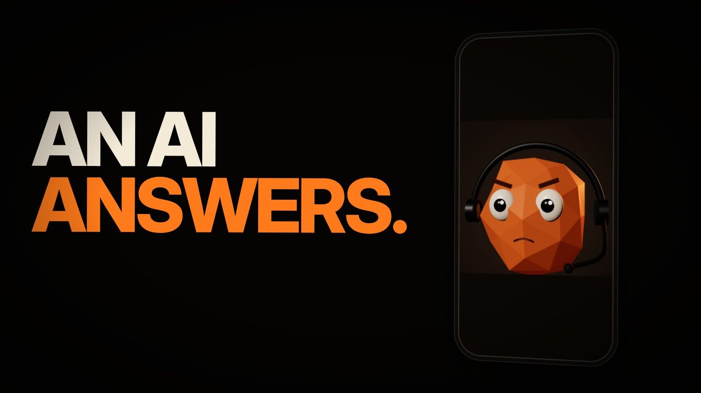

Chert is a real character, not a voice menu. He listens (OpenAI speech to text), thinks (an OpenAI model that knows the story and the live game state), and talks back in his own ElevenLabs voice. Ask him who Mabel is, why he needs the stone, or anything else, and he answers in his own words. When you agree to help, he starts the game.

### 2. The call becomes a game
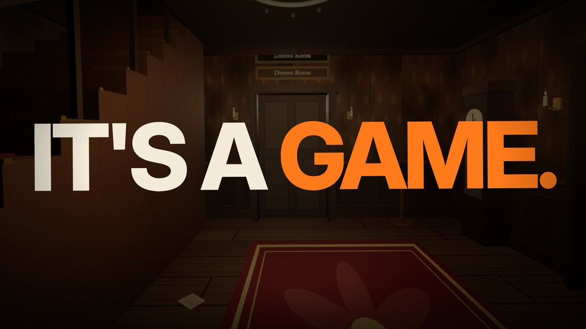

The haunted house is a full 3D game (three.js) with two floors, furnished rooms, stairs and a sealed red door. It runs in a hidden browser on our Mac, and its picture is streamed back into the call as Chert's camera. Everyone on the call sees it.

### 3. One call, two players
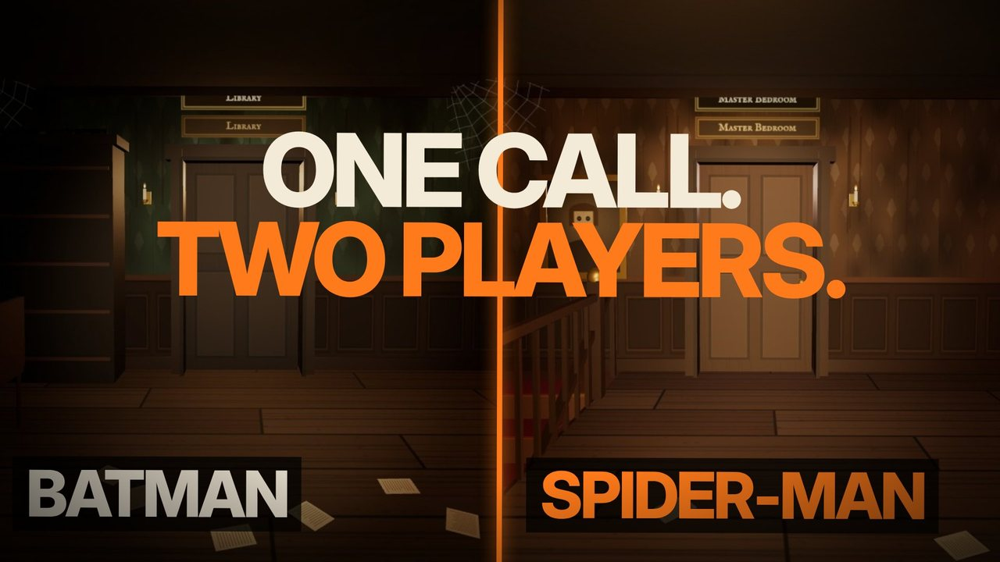

Chert's line gives our agent the whole FaceTime window as a single video. Our agent finds each caller's box in that window and cuts them apart, so every player gets their own camera. Two callers means two characters on one split screen, each moving through the house on their own. It's a race.

### 4. It sees you
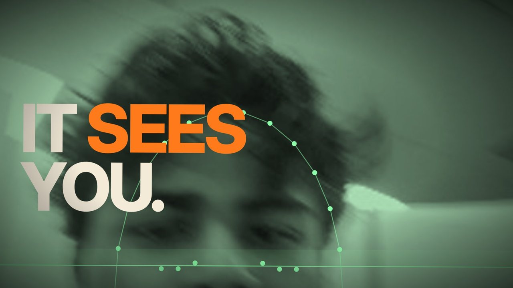

Each caller's camera box is tracked with MediaPipe: face landmarks, hand landmarks and a person mask. That's what lets the game know who is gesturing, whether you moved, and where to put Mabel.

### 5. Your hands are the controller
<p>
  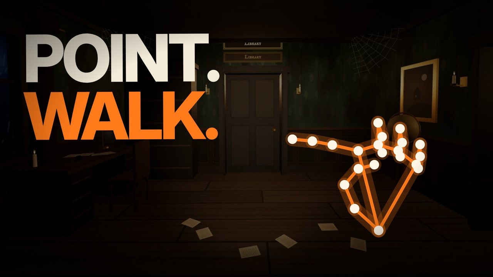
  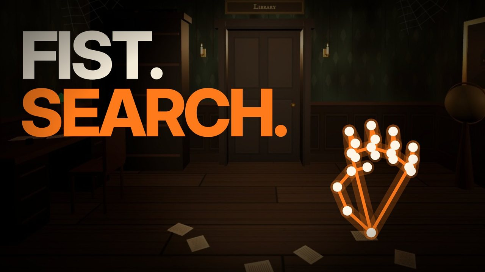
</p>

| Gesture | What it does |
|---|---|
| ☝️ Point left / right | Walk through that door |
| ☝️ Point up / down | Go forward or upstairs / back or downstairs |
| ✊ Fist | Search the furniture in front of you, or strike the stone |
| ✋ Open palm | Push Mabel back when she reaches for you |
| 👍 Thumbs up | Start the game |

Each player's hands only move their own character, because each hand is read from that player's own camera box.

### 6. Or just say it, and ask it anything
<p>
  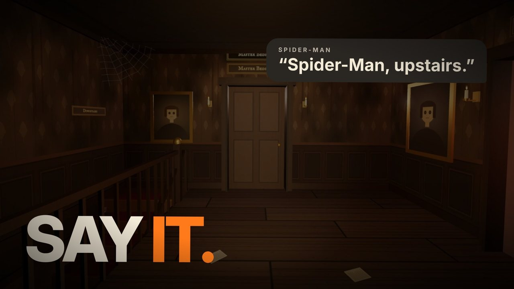
  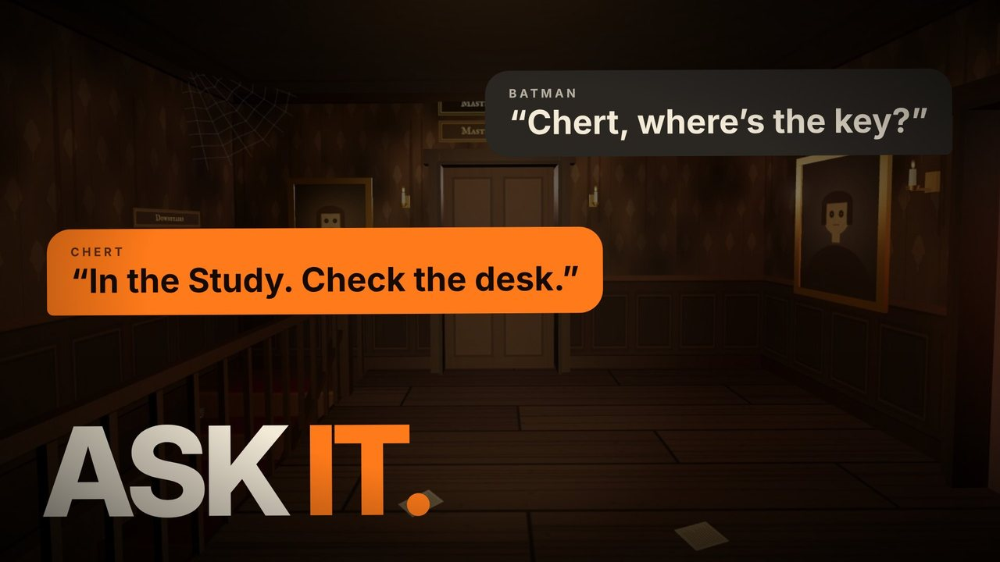
</p>

Voice works for everything: "Batman, left", "Spider-Man, search the desk", "upstairs", "strike it". FaceTime mixes everyone's voice into one feed, so in a two-player game you say your hero's name first. Questions like *"Chert, where's the key?"* go to the AI, and the hints get sharper the longer you're stuck: first a direction, then the room, then the exact piece of furniture.

### 7. The camera is part of the game
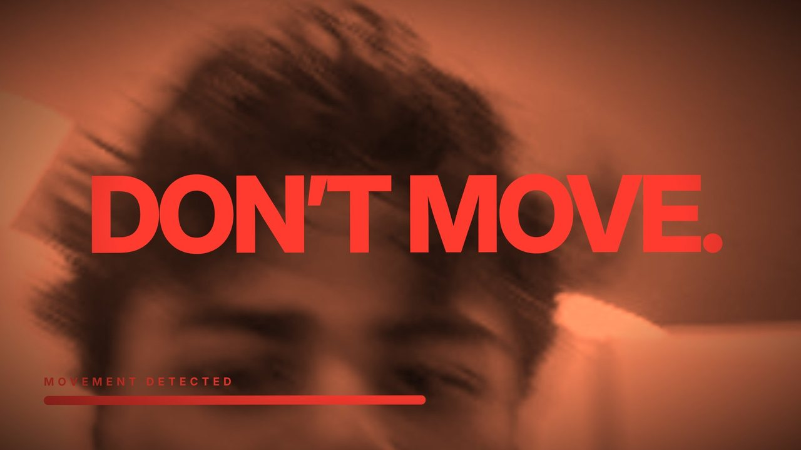

When Mabel finds you, she tests you. **Don't move**: the game watches your camera, and if you move, she gets you. Or she reaches for you and you have to **hold your palm up** to push her back.

### 8. Then she steps into your camera
<p>
  
  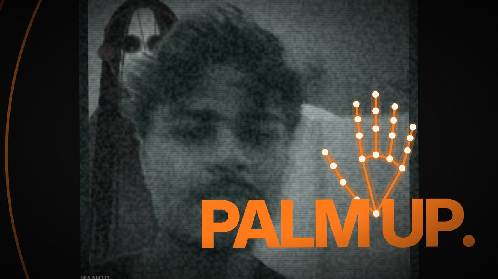
</p>

If Mabel catches you, your half of the screen cuts to **your own camera**, and she is standing behind you, in your real room. The person mask keeps you in front of her, so it looks like she is really there. It only happens to the player she caught.

### 9. Strike the stone, beat the clock
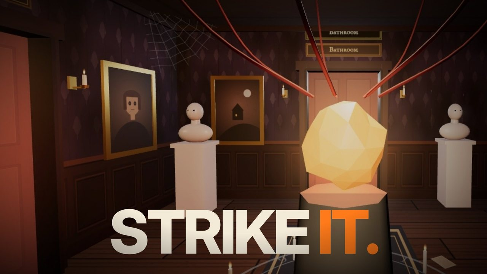

Chert's calls last five minutes, so the game has its own clock: "the line dies in m:ss". Chert warns you at 60, 30 and 10 seconds. Find the key, open the red door upstairs, and strike the stone before the line goes dead.

---

## How it works

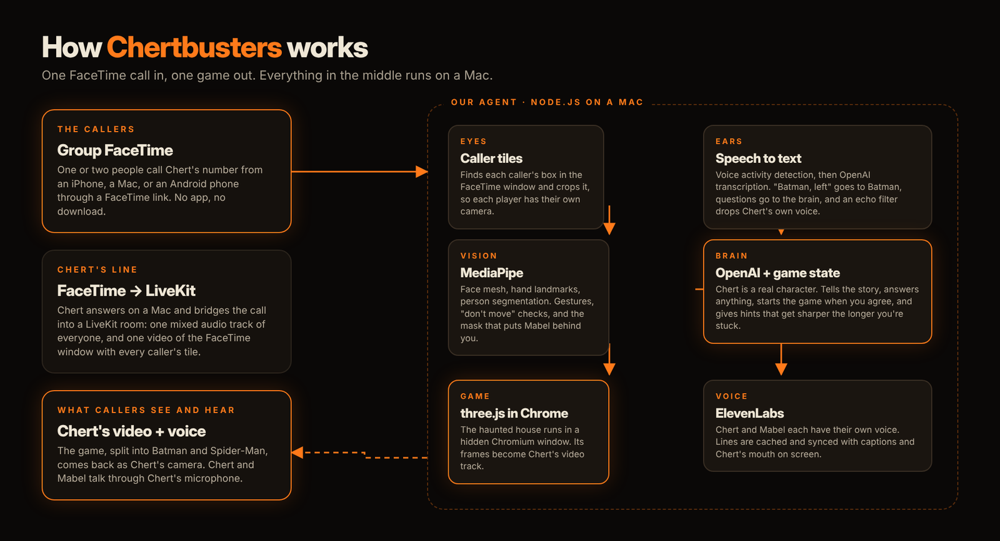

1. **Callers** start a group FaceTime with Chert's number. A friend can join from an iPhone, a Mac, or an Android phone through a FaceTime link.
2. **Chert's line** answers on a Mac and bridges the call into a LiveKit room as one participant: one mixed audio track and one video of the FaceTime window.
3. **Our agent** (Node.js, `agent/`) joins that room:
   - **Eyes:** `tiles.mjs` finds each caller's box in the FaceTime window, crops it and sends it to the game.
   - **Vision:** MediaPipe face mesh, hands and selfie segmentation run in the game page for gestures, movement checks and the Mabel cut-out.
   - **Ears:** energy-based voice detection plus OpenAI transcription. Hero names route commands; questions go to the brain; an echo filter ignores Chert's own voice.
   - **Brain:** an OpenAI model with tools (`start_game`, `choose_option`, `challenge_action`) and the live game state.
   - **Voice:** ElevenLabs for Chert and Mabel, cached and synced with captions.
   - **Game:** `game/index.html` (three.js) runs in headless Chromium. Its frames become Chert's camera track.
4. **The callers** see the game as Chert's video and hear Chert and Mabel through Chert's microphone.

## Tech

Chert FaceTime CLI · LiveKit Agents (Node) · three.js · MediaPipe (face mesh, hands, selfie segmentation) · OpenAI (speech to text and the brain) · ElevenLabs (voices) · Playwright + Chromium · sharp

---

## Run it

The runtime lives in `agent/`. See [`agent/README.md`](agent/README.md) for the full setup, demo checklist and troubleshooting.

```sh
cd agent
npm install
npx playwright install chromium
cp .env.example .env.local
chmod 600 .env.local
# fill in LIVEKIT_*, OPENAI_API_KEY, AGENT_NAME, and ElevenLabs keys if you have them
npm run preview          # play it on your Mac with your webcam, no FaceTime needed
```

For a real call, run these in two terminals, then FaceTime the line:

```sh
npm start
npx --yes @trychert/facetime@0.1.0-beta.21 dev --agent <AGENT_NAME> --minutes 30
```

For two players, the first caller taps **Share Link** in the call and the friend joins from it.

## Notes

- Chert's trial calls last five minutes. The game ends before the call does.
- FaceTime gives the agent one mixed voice feed, so voice commands in a two-player game start with the hero's name. Gestures don't need it.
- Mabel's camera moment uses the caller's own video only during the call. Nothing is recorded or stored.
- `.env.local` holds the keys and is never committed.

<p align="center"><b>Chertbusters.</b> The call is watching.</p>
